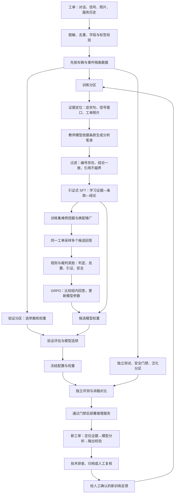

# AutoEvidence 项目流程图与两天面试学习路线

## 先确定这两天的目标

你的起点是 Agent 与服务工程，不是从零学习编程。已有的输入输出协议、模型调用、RAG、工具执行和部署经验可以直接迁移。需要补的是：如何用数据改变模型参数、如何设计优化目标、如何证明提升来自方法而非数据泄漏。

两天的合理目标是：能沿一条工单讲完整链路，能解释 SFT 与 GRPO 的核心机制，能检查代码是否真实完成训练，能回答主要实验问题。两天不能替代完整的大规模实验经验，参考文档中的参数与成绩不能当作本人已经验证的成果。

## 1. 项目总流程图

图中的教师和裁判主要用于离线数据构建与训练。部署时不需要为每条工单重新走一遍 SFT 或 GRPO。金标只能进入训练监督或独立评测，不能混进推理输入。

消融包含多个独立训练版本：关闭训练组件后要重新训练，再与完整方案在相同评测条件下对比，不是部署完成后随意开关一下。

## 2. 用你的 Agent 经验理解算法

| 你熟悉的工作 | 本项目对应工作 | 新增的关键认识 |
| --- | --- | --- |
| 给模型拼上下文 | 构造工单证据包 | 输入质量决定模型能否看到有效信息 |
| RAG 召回相关片段 | 找症状句、信号与故障照片 | 选中证据不代表证据足以支持结论 |
| 写 Prompt 和 few-shot | 设计训练样本与 SFT | Prompt 改本次输入，SFT 用梯度更新模型参数 |
| 写规则与验收器 | 设计奖励函数 | 模型会利用规则漏洞，得到高分不一定完成目标 |
| 调用模型生成回答 | GRPO rollout 采样候选 | 采样本身不是训练，必须计算目标并更新参数 |
| Agent 成功率评测 | 模型独立测试与消融 | 需隔离数据、冻结口径、检验泛化与因果归因 |
| vLLM 服务接入 | 训练后权重部署 | 训练生成新权重，部署负责加载权重并提供推理 |

SFT 是训练目标，LoRA 是参数高效更新方式。可以用 LoRA 做 SFT，也可以全参做 SFT；不要把两者当成两个互斥训练阶段。

## 3. 用一条工单贯穿学习

教学示例：车主说“冬天续航下降很多”，信号显示低温、电池健康度正常，无故障码，服务历史无异常。本例为简化示意，不代表真实车辆诊断标准。

1. **任务定义：** 输入工单；目标输出质量事件与否、问题类型、处置等级和依据。
2. **证据定位：** 保留续航下降描述、低温与健康度信号。不能看到“下降很多”就直接认定电池故障。
3. **金标：** 由质量专家依据完整证据和有效条款判断，不能用待训练模型自己给出的答案当独立真值。
4. **教师合成：** 把专家结论展开为可检查的证据与条款分析。教师生成不代表内容必然正确，需要过滤和抽检。
5. **SFT：** 让模型学习在类似证据下生成合适的分析与结论。交叉熵推动模型提高目标输出 token 的概率；条款段加权表示训练更重视这一段的误差。
6. **GRPO：** 同一工单生成几个候选，例如正常归档、质量事件紧急复核、证据不足人审。依据金标、证据与条款评分，比较组内相对好坏，优化模型生成行为。
7. **独立评测：** 换一辆未训练过的车或新场景检验，不能把这个训练例答对当成泛化能力。
8. **部署：** 加载训练后的模型，新工单直接推理；缺少关键证据时按规则转人工，而不是让模型硬猜。

## 4. 面试必须理解的八个问题

### ① 为什么不用 Prompt 就够了？

先建立零样本或 few-shot 基线，再看稳定性、依据质量和边界样本错误。只有实验表明训练有收益，才有理由增加训练复杂度。不能先认定 GRPO 必然比 SFT 好。

### ② SFT 到底在训练什么？

输入证据和条款，目标是专家认可的分析与结构化结论。前向计算输出 token 概率，交叉熵度量和目标答案的差距，反向传播得到梯度，优化器更新参数。输入 prompt 和 padding 通常不计目标损失。

### ③ 分段加权为什么有用？

普通 token 平均损失可能更偏向篇幅长的描述。增加条款对照段权重能提高它对训练目标的影响，但不保证更真实，需要通过消融和独立引证评测确认。

### ④ GRPO 如何接在 SFT 后面？

SFT 先让模型形成基本输出能力。GRPO 对同一输入采样 G 个回答并打分，用相对组均值的优势衡量哪个回答更好，再优化生成概率。裁剪约束单次更新，参考模型 KL 约束偏离程度。全同奖励组缺少相对信号，要明确跳过或其他处理方式。

第一遍只需记住：`相对优势 ≈ (本回答奖励 - 组平均奖励) / (组内奖励标准差 + ε)`。具体归一化与 KL 实现依采用的训练框架变体确定。

### ⑤ 奖励为什么可能把模型教坏？

若只处罚“安全事件判归档”，模型可能改判技术排查来躲处罚。若奖励长解释，模型可能写得很长却不提供新依据。因此必须覆盖可规避的处置路径，并独立检查真实安全指标、引证质量和奖励作弊案例。

### ⑥ 如何证明不是背答案？

先划分车辆与事件组，再做合成和增广；同源变体不跨分区；验证集用来选参数，测试集不能反复参与调参。补充新车型或不同输入形态泛化集。测试错例一旦用于训练，就需要新的独立留出样本。

### ⑦ 哪些指标不能混用？

事件 F1 衡量事件检出；误伤率分母是正常工单；安全处置召回分母是金标紧急复核样本；问题类型准确率只在金标事件上统计。引用编号真实存在和条款真正支持结论是两回事。

### ⑧ 本人到底做了哪些？

工程已做、算法方案设计、代码已实现、真实训练已跑、效果已验证要分别讲。可以说“我从 Agent 工程向训练与评测扩展”，不能把看过文档或 AI 生成代码说成完整主导了线上强化学习实验。

## 5. 两天安排：按每天约七小时净学习时间

| 时间 | 学什么、做什么 | 学完必须留下什么 |
| --- | --- | --- |
| 第一天 1 小时 | 读总流程与一个工单，明确输入、标签、条款、输出 | 不看材料画出训练与推理两条链路 |
| 第一天 1.5 小时 | 数据来源、车辆分组、增广与三道过滤 | 写一个 JSON 样本，解释每个字段和拒收条件 |
| 第一天 2 小时 | token、交叉熵、梯度、优化器、SFT 与 LoRA | 口述一次参数更新，能指出输入 mask 与分段权重位置 |
| 第一天 1.5 小时 | 规则基线、P/R/F1、误伤、安全门禁与消融 | 手算小样本指标，说明分母与泄漏风险 |
| 第一天 1 小时 | 检查代码进度；环境允许时跑数据 smoke 与 tiny SFT | 保存命令、输出和权重保存／重载证据，没跑则标未验证 |
| 第二天 2 小时 | GRPO：采样、奖励、优势、裁剪、KL、参数更新 | 对一组候选手算奖励和优势，解释为何不是简单选最高分 |
| 第二天 1.5 小时 | 裁判可靠性、奖励漏洞、难例与安全约束 | 写出三个作弊案例及对应修复方案 |
| 第二天 1 小时 | 读奖励、损失、split、评测与训练入口 | 找到对应实现，识别 placeholder 与 mock |
| 第二天 1 小时 | 检查真实验证、推理与实验报告 | 制作“已完成／未完成／未验证”清单 |
| 第二天 1.5 小时 | 录音模拟面试、回听并修正 | 形成 90 秒介绍与 5 分钟技术展开 |

如果只有一天，优先完成工单主线、SFT、数据隔离、指标和 GRPO 核心机制；缩减界面与部署细节、分布式实现细节。MoE 底层、CUDA 优化和从头预训练不在这次短期补课范围内。若已经写在简历里，必须至少能解释选择原因和本人接触边界。

## 6. 按这个顺序读现有参考文档

先读 `20261018_risk.md` 的第 1 节项目概述、第 2 节数据、第 3 节评测、第 4 节架构，最后读第 5 节实验。不要先背模型尺寸、显卡数量和成绩。

再按学习主题读取 `20261018_risk_QA.md`，优先回答：为什么这样设计、数据怎么隔离、损失怎么加权、奖励怎么打、失败了怎么办、实验如何证明。

代码完成后，优先看 schemas → data split → evidence → synthesis filters → SFT loss → rewards → GRPO trainer → metrics，最后看 API 和界面。

## 7. 面试自测与介绍模板

合上文档回答：

- 一条工单从输入到训练样本发生了什么？
- SFT 和推理调用到底差在哪里？LoRA 又是什么？
- 同一输入采样七个回答后，GRPO 还需要做哪些步骤？
- 裁判评分高，为什么可能仍然不可靠？
- 训练集、验证集、测试集分别做什么？
- 如何用实验区分信号输入、数据过滤和奖励设计的贡献？
- 哪些结果有代码或日志证据，哪些还只是方案？

90 秒介绍框架（只填实际完成内容）：

“我之前主要做 Agent 工程，擅长模型接入、上下文组织和执行闭环。这个项目把能力向模型训练扩展，解决汽车工单里口述与信号不一致、分析缺乏可靠依据的问题。输入是对话、信号、照片和历史，先定位证据，再构造带条款引用的 SFT 数据；后续用候选采样和组合奖励进行 GRPO 优化。评测重点是事件检出、误伤、引证与安全处置，并通过车辆隔离和消融检查真实性。我实际完成了【模块】，运行验证了【实验】，正式大模型训练与线上效果目前是【真实状态】。”

这份项目证明材料应随着实际实现更新。现有参考文档的数字属于待核验材料，不是这两天学习之后自动获得的个人履历。
